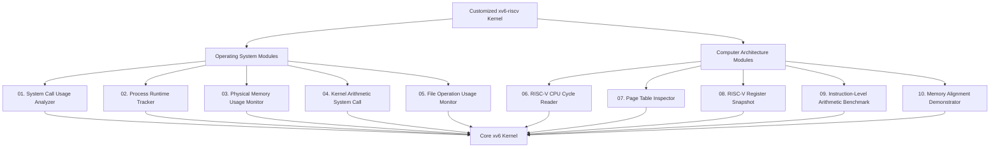

# Customized xv6-riscv Kernel

This project contains 10 modules: 5 Operating System modules and 5 Computer Architecture modules.

## Module Architecture Diagram

## Project Overview

This project extends the MIT xv6-riscv teaching operating system with
10 educational modules. The modules are divided into two categories:
5 Operating System modules and 5 Computer Architecture modules.

The purpose of this project is to understand operating system concepts,
kernel development, system calls, process management, memory management,
and RISC-V processor architecture through practical implementation.

## Module Descriptions

### Operating System Modules

#### 01. System Call Usage Analyzer
Tracks system call usage to help understand how user programs interact
with the xv6 kernel and how system calls are counted.

#### 02. Process Runtime Tracker
Tracks process runtime information to demonstrate process execution
and the role of timer interrupts in operating system scheduling.

#### 03. Physical Memory Usage Monitor
Provides information about physical memory usage to help understand
memory allocation and resource management in the kernel.

#### 04. Kernel Arithmetic System Call
Demonstrates how to add a custom arithmetic system call and connect
a user program with kernel functionality.

#### 05. File Operation Usage Monitor
Monitors file operation activity to demonstrate how file-related
operations are handled and tracked in an operating system.

### Computer Architecture Modules

#### 06. RISC-V CPU Cycle Reader
Demonstrates reading the RISC-V cycle counter, where supported,
to explore processor cycles and low-level hardware information.

#### 07. Page Table Inspector
Helps examine page table entries and understand virtual-to-physical
address translation and memory protection.

#### 08. RISC-V Register Snapshot
Demonstrates collecting selected RISC-V register values to explore
processor state and register-level information.

#### 09. Instruction-Level Arithmetic Benchmark
Compares arithmetic workloads to explore execution time and
performance measurement at the instruction and software levels.

#### 10. Memory Alignment Demonstrator
Demonstrates memory alignment concepts and their relationship to
data access, memory layout, and processor architecture.

## Learning Objectives

- Understand how user programs interact with the xv6 kernel.
- Learn how system calls are declared, implemented, and tested.
- Explore process scheduling, memory management, and file operations.
- Study RISC-V counters, registers, page tables, and memory alignment.
- Practice modifying, building, testing, and documenting an operating system.

## Project Structure

- `kernel/` — kernel source code and operating system functionality.
- `user/` — user programs and user-space system call interfaces.
- `Makefile` — build configuration for xv6-riscv.
- `README.md` — project documentation and module architecture.

xv6 is a re-implementation of Dennis Ritchie's and Ken Thompson's Unix
Version 6 (v6).  xv6 loosely follows the structure and style of v6,
but is implemented for a modern RISC-V multiprocessor using ANSI C.

ACKNOWLEDGMENTS

xv6 is inspired by John Lions's Commentary on UNIX 6th Edition (Peer
to Peer Communications; ISBN: 1-57398-013-7; 1st edition (June 14,
2000)).  See also https://pdos.csail.mit.edu/6.1810/, which provides
pointers to on-line resources for v6.

The following people have made contributions: Russ Cox (context switching,
locking), Cliff Frey (MP), Xiao Yu (MP), Nickolai Zeldovich, and Austin
Clements.

We are also grateful for the bug reports and patches contributed by
Abhinavpatel00, Takahiro Aoyagi, Marcelo Arroyo, Hirbod Behnam, Silas
Boyd-Wickizer, Anton Burtsev, carlclone, Ian Chen, clivezeng, Dan
Cross, Cody Cutler, Mike CAT, Tej Chajed, Asami Doi,Wenyang Duan,
echtwerner, eyalz800, Nelson Elhage, Saar Ettinger, Alice Ferrazzi,
Nathaniel Filardo, flespark, Peter Froehlich, Yakir Goaron, Shivam
Handa, Matt Harvey, Bryan Henry, jaichenhengjie, Jim Huang, Matúš
Jókay, John Jolly, Alexander Kapshuk, Anders Kaseorg, kehao95,
Wolfgang Keller, Jungwoo Kim, Jonathan Kimmitt, Eddie Kohler, Vadim
Kolontsov, Austin Liew, Bruce Lowekamp, l0stman, Pavan Maddamsetti,
Imbar Marinescu, Yandong Mao, Matan Shabtay, Hitoshi Mitake, Carmi
Merimovich, mes900903, Mark Morrissey, mtasm, Joel Nider, Hayato Ohhashi,
OptimisticSide, papparapa, phosphagos, Harry Porter, Greg Price, Zheng
qhuo, Quancheng, RayAndrew, Jude Rich, segfault, Ayan Shafqat, Eldar
Sehayek, Yongming Shen, Fumiya Shigemitsu, snoire, Taojie, Cam Tenny,
tyfkda, Warren Toomey, Stephen Tu, Alissa Tung, Rafael Ubal, unicornx,
Amane Uehara, Pablo Ventura, Luc Videau, Xi Wang, WaheedHafez, Keiichi
Watanabe, Lucas Wolf, Nicolas Wolovick, wxdao, Grant Wu, x653, Andy
Zhang, Jindong Zhang, Icenowy Zheng, ZhUyU1997, and Zou Chang Wei.

ERROR REPORTS

Please send errors and suggestions to Frans Kaashoek and Robert Morris
(kaashoek,rtm@mit.edu).  The main purpose of xv6 is as a teaching
operating system for MIT's 6.1810, so we are more interested in
simplifications and clarifications than new features.

BUILDING AND RUNNING XV6

You will need a RISC-V "newlib" tool chain from
https://github.com/riscv/riscv-gnu-toolchain, and qemu compiled for
riscv64-softmmu.  Once they are installed, and in your shell
search path, you can run "make qemu".
